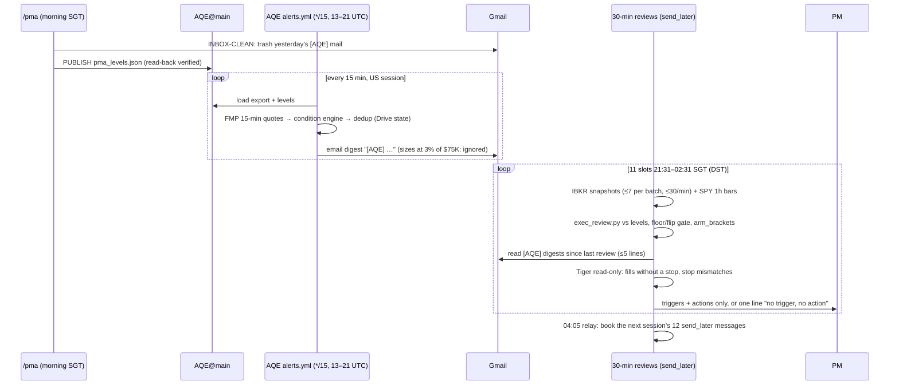

# Aegis PMA — Architecture, Orchestration & Alerts: Baseline for a Claude Code Assessment

| | |
|---|---|
| **Date** | Thu 29 Oct 2026 (SGT) |
| **Purpose** | Describe the PMA plugin as it actually runs today, so the PM can judge whether it should move from the claude.ai harness to Claude Code |
| **Sources** | Installed plugins (`aegis-core` 1.30.0, `aegis-voices` 1.8.0, `aegis-daily` 1.2.1, `aegis-stops` 0.1.0; kernel build `cf837be`), `skills/pma/RUN.yaml` (updated 2026-10-23), `RULINGS.yaml` (R1–R29), `TongIncomeWheel/AQE@main` (workflows, `src/alerts/`, `aegis/output/pma/run/2026-10-29/`), the live-review spec (2026-10-23) |
| **Status** | Descriptive baseline + an assessment framework. Not a recommendation. |

---

## 1. Bottom line

- **PMA is a conductor, not an agent.** One control-plane session walks a 19-step map in `RUN.yaml`. 14 steps are deterministic Python, 5 steps spawn models (26 spawns). Every step reads files, writes files and ticks a scoreboard (`run_manifest.json`).
- **The design already assumes a hostile runtime.** Steps can be resumed, nothing is held in the conductor's memory, and nothing is trusted unless it has been pushed. Most of the 29 rulings exist because the current harness lost files, compacted context or ran agents without tools.
- **Alerts run outside Claude.** AQE's GitHub Actions job checks every 15 minutes and emails digests. Claude's part is (a) publishing the levels AQE watches, (b) trashing the alert mail each morning, and (c) 11 scheduled 30-minute reviews per US session.
- **What to test in Claude Code:** the main pain points are disposable disk, no byte-exact git push, voice agent types that have no file tools, and checks that rely on the conductor remembering to run them. A Claude Code runtime targets all four. The cost of moving is losing claude.ai-only pieces: the fixed artifact URL, `send_later`, phone push, and the hosted Gmail, IBKR and Tiger connectors.

---

## 2. Plugin topology

| Plugin | Layer | Holds | Can place orders? |
|---|---|---|---|
| **aegis-core** 1.30.0 | process | `/pma` conductor, `/committee-pm`, `/market_hours`, `/bracket`, `/recover`, `cio-voice`; agents `data-steward`, `committee-desk`, `brief-writer`, `staging-gatekeeper`; charter (constitution, rulebook, parameters, decisions log); ~60 tools | Only `staging-gatekeeper` (armed switch) |
| **aegis-voices** 1.8.0 | knowledge | 15 seat cards + signed canon locks (378 principles, 159 recognisers), `voice-common` engine, nomination contract | No |
| **aegis-daily** 1.2.1 | process | `/daily`, `/ptj`, `/premarket`, `print-trade-journal`: book close, journal, held-book refresh | No |
| **aegis-stops** 0.1.0 | process | `/stops`: reconcile Tiger stops against committee stops, raises only | No (it writes amend requests) |

**Code footprint:** ~26.5k lines of Python across `tools/` and `skills/pma/tools/`, plus ~270 regression tests (1.24.0 changelog). **Authority order:** `RUN.yaml` and `RULINGS.yaml` win over `SKILL.md`. The repo (`TongIncomeWheel/AQE@main`) wins over the bundled plugin copy.

---

## 3. System architecture

```mermaid
flowchart LR
  subgraph AQE["AQE engine (outside Claude)"]
    HF["HF Space<br/>Streamlit + scheduler daemon"]
    GHA["GitHub Actions<br/>daily-run · voice-packets-sync 04:00 UTC<br/>refresh-held · alerts */15 13–21 UTC"]
    OUT["AQE@main aegis/output/<br/>export · candidate_set · packets/<br/>crown macro · valen dashboard"]
    HF --> OUT
    GHA --> OUT
  end

  subgraph CLAUDE["Claude harness (claude.ai cloud session, ephemeral container)"]
    COND["/pma CONDUCTOR<br/>control plane"]
    TOOLS["Deterministic tools<br/>registrar · pma_pipeline · purity_check<br/>pm_lens · pma_conditions · pma_levels<br/>pma_scorecard · pma_cards"]
    SEATS["26 model spawns<br/>macro 2 · nominate 9 · challenge 4<br/>vote 10 · write 1"]
    COND --> TOOLS
    COND --> SEATS
  end

  OUT -->|GATHER read| COND
  FMP["FMP<br/>fundamentals, closes, bars"] --> COND
  TIGER["Tiger MCP<br/>positions, orders (read-only)"] --> COND
  GMAIL["Gmail<br/>INBOX-CLEAN"] <--> COND

  COND -->|PUBLISH aegis/output/pma/| LV["pma_levels.json<br/>scorecard_log.jsonl<br/>run/DATE/"]
  COND -->|REPORT| ART["Card report<br/>one fixed artifact URL"]
  LV --> ALERT["AQE alert loop<br/>15-min quotes, condition engine"]
  ALERT -->|email digest '[AQE]'| GMAIL
  LV --> LIVE["30-min live reviews<br/>exec_review.py + IBKR snapshots"]
  GMAIL --> LIVE
  LIVE --> PM(("PM<br/>executes manually<br/>via Tiger preview"))
  ART --> PM
```

### The three planes (rulebook `model_tiers`, D-16)

| Plane | Who | Model | Job |
|---|---|---|---|
| **Data** | `tools/*.py` | none | Every number: tally, rank, consensus, brackets, levels, scorecard |
| **Control** | conductor, data-steward, gatekeeper relay | capable model (sonnet tier) | Sequencing, contract checks, choosing a degradation path. No market opinion (R9) |
| **Judgment** | voices, committee-desk, brief-writer | opus (pinned in agent files) | Nomination, challenge, vote, narrative |

### Constitutional laws that shape the architecture

1. **Execution boundary:** default is PREVIEW, and only the gatekeeper can touch an order. PMA itself is order-blind ("Nothing is staged, nothing is armed" footer, R10).
2. **Read, never invent:** figures come from the export and calculators. A gap is declared, never filled.
3. **Code computes, models judge:** verdicts are never tallied by hand. `pma_pipeline.py consensus` is the only verdict source.
4. **Independence before consensus:** seats run blind and isolated. No seat sees another seat or the tally.
5. **Neutral ground:** law and code live in git, so no vendor holds the only copy.

---

## 4. The PMA run: step map

```
INBOX-CLEAN → GATHER → PREPARE → [MACRO ∥ NOMINATE] → RANK ─┬→ CHALLENGE → VOTE → DECIDE → CONDITIONS
   → REPEAT-WATCH → BRACKET → SCORECARD ─┬→ WRITE → CHECK → LEVELS → REPORT → PUBLISH
                         PM-LENS (independent lane, feeds nothing) ─┘
```

| # | Step | Kind | Spawns | What it does | Barrier / on fail |
|---|---|---|---|---|---|
| 1 | INBOX-CLEAN | tool (Gmail) | – | Trash `from:"AQE Alerts"` threads and threads whose subject literally starts with `[AQE]`. GitHub `[TongIncomeWheel/AQE]` mail is skipped (R24) | 0 remaining; on fail, declare and continue |
| 2 | GATHER | tool | – | Pull export, crown macro, Valen dashboard, candidate set, packets, ledgers from AQE main; FMP fundamentals; Tiger orders and positions → `broker_stops.json`; record tool sha256 (R7) | **FATAL** if there is no export |
| 3 | PREPARE | tool | – | Verify packets only, no re-filtering (R5); held floor on every packet (R12) | Every seat has a packet with md5 |
| 4 | MACRO | model | 2 | Crown + Druckenmiller weather (expression family, size multiplier, no tickers) | 2/2, then checkpoint |
| 5 | NOMINATE | model | 9 | Blind nominations: elder-lens, livermore, minervini, oneil, raschke, seow, thorp, weis, wyckoff | 8/9, otherwise **halt** |
| 6 | RANK | tool | – | Tally, then the room. **Floor** = every nomination + every held name, never cut (R16). **Doors** add up to 8 more. Strong seats (R27, 10) and U&R seats (R25, 3). Lane = MOMENTUM or PULLBACK (R14) | `cmd_rank` aborts if a nomination is cut |
| 7 | PM-LENS | tool | – | PM's 6 checks on the full export; blocks nothing, rejoins at WRITE | – |
| 8 | CHALLENGE | model | 4 | Rogers (crowding/certainty), Steenbarger, Lynch (fundamentals, consulted only, R22), Detect-lens | 4/4, then checkpoint |
| 9 | VOTE | model | 10 | Every seat votes on every room name from one identical `VOTE_PACKET.txt`. Every SUPPORT carries a conditions block in the shared vocabulary (R21). Ballots can be split into parts (R16.1) | 8/10, otherwise watch-table-only run |
| 10 | DECIDE | tool | – | Verdict rule (§5); writes the verdict ledger before any narrative (R8) | – |
| 11 | CONDITIONS | tool | – | Compile seat conditions into numeric triggers → `cards.json` | Declared on fail |
| 12 | REPEAT-WATCH | tool | – | Repeat names + `purity_check` (rank must not change with bracket or fundamental fields) | Invariance PASS, max 2 fix loops |
| 13 | BRACKET | tool | – | Queue levels for ADVANCE and HOLD names (after the vote, render-only, R18); repeat marks (R19) | – |
| 14 | SCORECARD | tool | – | Grade past calls vs SPY, vs the AQE list they came from, and beta-adjusted; append to log | Exit 3 = price mismatch |
| 15 | WRITE | model | 1 | brief-writer → `pma_brief_<date>.md` + `cards_text.json` (words only) | **The brief always lands**, degraded if it has to |
| 16 | CHECK | tool | – | `pma_pipeline.py gate` | 0 FAIL, max 2 loops |
| 17 | LEVELS | tool | – | `pma_levels.py emit --window 3`: rolling 3-session alert file (R20/R20.1). Refuses a committee exit set below the broker stop | Refuses on a broken contract |
| 18 | REPORT | tool | – | `pma_cards.py render`: layout fixed in code (R23), Part 1 Daily Weather (R28/R29), published to **one fixed artifact URL** | Refuses on a missing card |
| 19 | PUBLISH | tool | – | Push levels, scorecard and run files to `AQE@main aegis/output/pma/`, read back and verify; print the brief | Never tick on an unverified file |

**The loop around each step:** `preflight_run.py step` → run the step → `registrar.py validate --packet` → `commit` → `git_sync` (checkpoint steps) → `meter` → `tick`. `/pma resume` restarts at the first step not ticked done.

**Measured cost:** about 905k model tokens for a clean run (VOTE 352k, WRITE 240k, NOMINATE 172k, CHALLENGE 107k, MACRO 34k), plus conductor overhead.

---

## 5. Deliberation mechanics

| Element | Mechanism |
|---|---|
| **Isolation** | Each seat sees only its own card + packet. Spawned directly by the conductor, never through a delegate (R3) |
| **Seat transport (current harness)** | The compiled `aegis-voices:voice-*` agent types have `tools: []`. Seats therefore run as **general-purpose agents told to read their card and packet by path**, and the figure audit stands in for packet inlining (recorded 2026-10-23) |
| **Form validation** | `registrar.py` rejects malformed or off-universe forms, figures not in the packet, numeric levels inside conditions, and vocabulary outside the seat's own method. One respawn, then the seat is marked absent |
| **Admission** | Additive floor (R16): no analyst pick is ever removed. Machine doors only add names. Strongest names get voted in the momentum lane (R27) |
| **Lanes** | MOMENTUM-lane verdicts count only the strength seats; other votes are advisory (R14) |
| **Verdict rule** | `ADVANCE` = support > oppose AND support ≥ 2 AND median support conviction ≥ 3 · else support ≥ 2 → `HOLD-FOR-CONDITIONS` (with an observable condition) · else `PASS` |
| **Bias controls** | Brackets are hidden from seats (R1/R18); purity check proves rank invariance; Rogers challenges crowding; sector is weather, not a gate (R4) |
| **Memory** | `verdict_ledger.json` (2.4 MB on 29 Oct) and `phase4_ledger.json` feed repeat-watch, repeat marks and the scorecard |

**Today's run (29 Oct):** 52 names in the room, 10 voters → 5 ADVANCE (HOG, CART, CNQ, CDW, EMR), 38 HOLD, 9 PASS. The vote packet was 130.5 KB and the markdown brief 406 KB.

---

## 6. Daily outputs

| Output | Where | Consumer |
|---|---|---|
| **CIO brief** `pma_brief_<date>.md` (16 sections: verdicts, consensus, macro, Valen, sectors, held book, repeat watch, PM lens, cards, near misses, plan, vote record) | Printed in chat; `aegis/output/pma/run/<date>/` | PM |
| **Committee Cards report** (HTML, fixed layout) | **One fixed claude.ai artifact URL**, updated in place (R23) | PM's primary read |
| **`pma_levels.json`** (ADVANCE / HOLD / HELD / WATCH rows with numeric triggers, too-late and kill prices, conditions, rolling 3-session window) | `AQE@main aegis/output/pma/pma_levels.json` + `levels/<date>.json` | AQE alert loop; live reviews |
| **Scorecard** `scorecard.md` + `scorecard_log.jsonl` | `aegis/output/pma/scorecard/` | Brief, card report, trend review |
| **Ledgers + run notes** (declared gaps, open PM decisions) | `aegis/output/pma/run/<date>/` | Next run; audit |

**Path rule:** every write goes under `aegis/output/**`. `deploy-hf.yml` redeploys the HF Space on any other push to main, which kills the running container.

---

## 7. Alerts management, end to end



| Layer | Component | Notes |
|---|---|---|
| **Producer** | AQE `scripts/alert_poll.py` in GitHub Actions (+ in-app poller on the HF Space; both share Drive dedup state) | Code watches, agents wake. No Claude tokens spent watching |
| **Contract** | `pma_levels.json` (R20/R20.1/R21) | Trigger ids stamped `<origin_run>:<id>`, so a fire is remembered for the row's whole life |
| **Delivery today** | Email `[AQE]` digests → read by the 30-min reviews | PM preference (2026-10-28): alerts stay **native in Claude chat**, no IBKR alerts, no email to him |
| **Hygiene** | INBOX-CLEAN each morning (R24) | The overnight reviews have already read the alerts |
| **Live review engine** | `exec_review.py` + `REVIEW_SPEC.md` + `ibkr_conids.json` + `arm_brackets.json` + `pm_watch.json`, all in `/home/claude/pma/live/` | Restored from project docs whenever the container resets |
| **Scheduling** | `send_later` chain: each 04:05 relay books the next session (rate-limited at ~9 bookings per burst) | A single relay failure breaks the chain |
| **Doctrine (aegis-core `market_hours`)** | Routing table (MOVE → drop; NEAR_STOP/VETO_HELD held → page; NEAR_TARGET → manage; BOS/NEAR_BREAKOUT + valid bracket → Intraday Review Pod), haiku watch tier, armed auto-execute ≥ 6 voices (default OFF) | This describes the Drive `aqe_alert_ledger.json` path. **The live practice has moved to levels + email + scheduled reviews**, so the doctrine and the live practice have diverged (open backlog #1, 29 Oct) |

---

## 8. Friction in the current harness (evidence)

| # | Friction | Evidence | Workaround in place |
|---|---|---|---|
| F1 | **Disposable disk** | S0: "wiped five times in one build"; live folder restored from project docs | Checkpoint pushes; restore-from-project procedure |
| F2 | **Checkpoint conflicts with the deploy rule** | 29 Oct run notes: "NO MID-RUN CHECKPOINT PUSHES … `git_sync.py` default paths include `aegis/data`, which rebuilds the HF Space". The run sat on local disk until PUBLISH, even though RUN.yaml checkpoints MACRO, NOMINATE, CHALLENGE, VOTE and WRITE | Accepted risk: about 900k tokens of work were exposed to a container reclaim |
| F3 | **No byte-exact git push** | PUBLISH: the connector takes inline text; on 30 Sep a transcription slip (APH mp 56.0 vs 60.0) was caught only by read-back; `scorecard.json` (~150 KB) is too large to transcribe | Read-back on every push; `levels_parts` split transport |
| F4 | **Agent types without file tools** | Voice agents `tools: []`; brief-writer returned `tool_uses:0` twice (2 Sep) | Spawned as general-purpose agents with the card inlined or read by path |
| F5 | **Checks depend on the conductor remembering them** | R2 md5 "never ran once"; GATHER ticked done with outputs in the wrong place (15 Sep) | `tick` refuses missing outputs; `preflight_run.py` |
| F6 | **Context compaction mid-run** | Reason RUN.yaml replaced the 117-line prose card | Scoreboard + `/pma resume` |
| F7 | **Rate-limited scheduling chain** | `send_later` ~9 per burst, background-sleep workaround | Relay at 04:05 |
| F8 | **Large artifacts through the model** | 130 KB vote packet × 10 seats; 406 KB brief | Accepted; tokens metered |
| F9 | **Doctrine drift** | Two skills still describe a `/committee-pm` and Drive alert-ledger world that `/pma` v5 replaced; a voice card (Raschke ADX) is stale against the packet | Manual notes in run declarations |

---

## 9. Claude Code assessment framework

Verify each capability against current Claude Code docs before scoring it. Upgrades since mid-2026 should be confirmed, not assumed.

### 9.1 Where Claude Code could improve things

| Friction | Claude Code capability to test | Test that proves it |
|---|---|---|
| F1, F2 | Persistent local or self-hosted checkout (dedicated box / VM) | Kill the session after VOTE and run `/pma resume`: VOTE forms still present with no push |
| F3 | Native `git push` with a PAT or deploy key; `git_sync.py` scoped to `aegis/output/**` only | Blob sha of pushed `pma_levels.json` equals `git hash-object` locally on the first try; `scorecard.json` pushed whole |
| F4 | Subagents defined in `.claude/agents/` with explicit `tools:` and `model:` | All 9 NOMINATE seats run from their own compiled agent files, read their packets, and `registrar validate` passes with no general-purpose workaround |
| F5 | **Hooks** (e.g. PreToolUse / PostToolUse / Stop) | A hook blocks a seat spawn if `preflight_run.py step` was not run, and blocks `tick done` unless `registrar validate --packet` exited 0 |
| F6 | Headless / non-interactive runs (`claude -p`), with the scoreboard driving step selection | A full run with zero interactive turns, and a resumed run after a forced kill |
| F7 | Cron or GitHub Actions launching headless reviews | 11 reviews fire from a scheduler with no relay chain; a missed slot does not break the next |
| F8 | Tools reading big files directly from disk | Vote packet read by path in every seat with no inline transcription; measure token delta vs the 905k baseline |
| F9 | Single repo as the plugin source (`AQE@main` checked out = what runs) | `preflight_run.py stamp` sha matches repo HEAD with no bundled-copy fallback |

### 9.2 What would be lost or need rebuilding

| claude.ai dependency | Used by | Replacement to cost |
|---|---|---|
| **Hosted connectors**: Gmail, Tiger MCPv7, IBKR, FMP, Google Drive, GitHub | GATHER, INBOX-CLEAN, live reviews, PTJ | Self-configured MCP servers or direct APIs (Gmail OAuth, Tiger SDK, IBKR Client Portal/TWS, FMP key). **This is the biggest migration line item.** IBKR's hosted connector in particular may have no drop-in equivalent |
| **Fixed artifact URL** for the card report (R23) | REPORT | Static HTML on GitHub Pages / HF Space, or keep a thin claude.ai step just to publish |
| **`send_later` + phone push** | Live reviews, relay, `notify.py` "cowork" channel | A scheduler plus a push channel (WhatsApp/Twilio path already stubbed in `notify.py`) |
| **Chat as the PM surface** (preference: alerts native in chat) | Reviews, brief | Decide whether a terminal or mobile Claude Code surface satisfies "native in chat" |
| **Project docs as the restore source** | Live folder restore | Not needed if the disk persists; otherwise use the repo |
| **Memory / project context** | Session protocol, gates | `CLAUDE.md` in the repo (AQE already has one) |

### 9.3 Decision criteria

| Criterion | Weight (PM to set) | Current harness | Claude Code: to measure |
|---|---|---|---|
| Run completes end to end without manual repair | | Usually; declared repairs most days | |
| Durable mid-run state (survives a kill after VOTE) | | No (F2) | |
| Byte-exact publish on the first push | | No (F3) | |
| Seats run as their own pinned agent files | | No (F4) | |
| Rulings enforced by machine, not by memory | | Partial (F5) | |
| Model tokens per clean run | | ~905k + overhead | |
| Wall clock to brief | | Measured by `registrar.py status` | |
| Live reviews fire on schedule, 11/11 | | Relay-dependent (F7) | |
| Alert delivery meets the "native in chat, no email" preference | | Partial: email is still the transport | |
| Broker read access (Tiger, IBKR) intact | | Yes, via hosted connectors | |
| Order boundary intact (gatekeeper only, armed only) | | Yes | Must stay yes |

### 9.4 Suggested pilot (no change to production)

1. **Shadow run:** check out `AQE@main` locally in Claude Code and run `/pma` for one session in parallel, publishing to a scratch path under `aegis/output/assess/shadow/` only (no HF redeploy, AQE does not read it).
2. **Diff the outputs:** verdicts, room membership and `pma_levels.json` should be identical given the same inputs, because the verdict is tool-computed. Any difference is a harness defect, not a market view.
3. **Instrument:** tokens, wall clock, repairs needed, pushes needed, and whether the hooks caught a deliberately skipped validation.
4. **Live-review pilot:** one session of headless reviews from a scheduler, compared slot-by-slot with the `send_later` chain.
5. **Connector proof first:** confirm Tiger read, IBKR snapshot and Gmail trash work from Claude Code **before** the shadow run. A connector gap fails the whole case.

---

## 10. Open questions for the PM

1. Where would Claude Code run: the PM's machine, an always-on VM, or GitHub Actions? This decides F1, F2 and F7.
2. Is the card report allowed to leave claude.ai artifacts (e.g. a GitHub Pages URL)?
3. Should the alert transport move off email (e.g. AQE pushes straight to a channel Claude Code reads), given the "native in chat" preference?
4. Should backlog #1 (streamline AQE alerts vs U&R vs multi-timeframe) be settled before or after a migration? Moving first would carry the doctrine drift (F9) across.

*Descriptive document. Nothing is staged, nothing is armed.*
